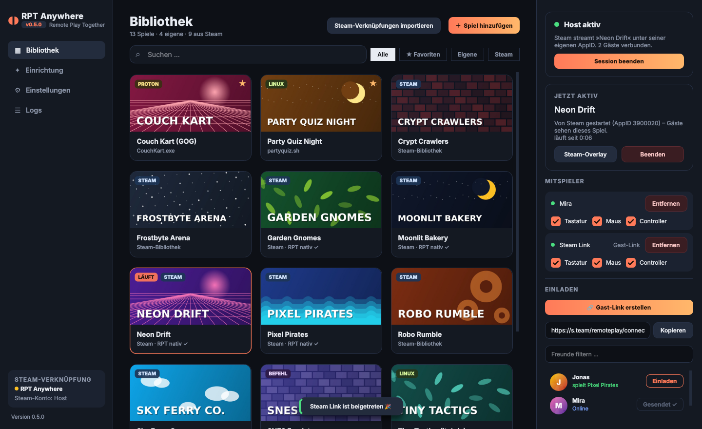
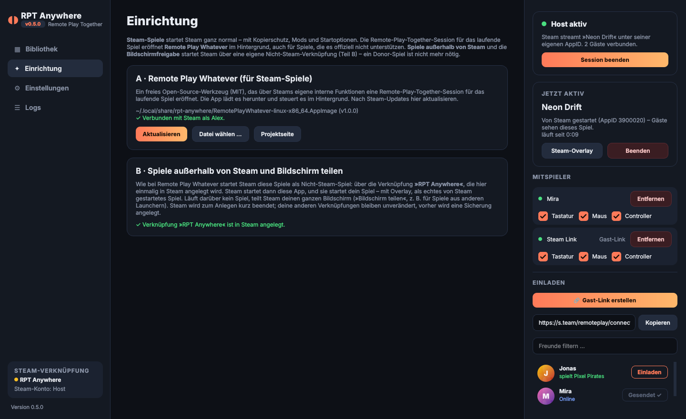

<div align="center">


# RPT Anywhere

**Steam Remote Play Together für _jedes_ Spiel unter Linux**

Steam-Spiele ohne Remote-Play-Together-Unterstützung – auch mit Kopierschutz, Mods oder eigener Steam-Anmeldung –, dazu Windows-Spiele von GOG/Epic/itch.io über Proton, native Linux-Spiele, Emulatoren oder beliebige Befehle: Streame sie mit Steams Remote Play Together an deine Freunde, lade sie mit einem Klick ein oder schick einen Gast-Link.

[](https://github.com/Schnubbirunkel/rpt-anywhere/releases/latest)
[](LICENSE)


[English](README.md) · **Deutsch**



</div>

## Funktionen

- **Jedes Steam-Spiel** – Steam startet das Spiel selbst (Kopierschutz, Mods und Startoptionen funktionieren); [Remote Play Whatever](https://github.com/Casual-Gamer8001/RemotePlayWhatever) eröffnet im Hintergrund die Remote-Play-Together-Session dafür, auch wenn das Spiel es offiziell nicht unterstützt
- **Spiele außerhalb von Steam** – Windows-Spiele über Proton (auch GE-Proton), Wine, native Linux-Programme, AppImages, Emulatoren oder beliebige Shell-Befehle; Steam startet sie über die eigene Nicht-Steam-Verknüpfung von RPT Anywhere – ohne Donor-Spiel
- **Bildschirm teilen** – für Spiele, die Steam nicht starten kann (andere Launcher): Steam teilt deinen ganzen Bildschirm
- **Einladen mit einem Klick** – Freundesliste mit Online-Status, Gast-Links für Leute ohne Steam-Account (landen automatisch in der Zwischenablage), verbundene Mitspieler mit Schaltern für Tastatur/Maus/Controller pro Gast und Entfernen-Knopf
- **Schöne Bibliothek** – Cover, Favoriten, Suche und Filter, Spiele per Drag & Drop hinzufügen, Import deiner Nicht-Steam-Verknüpfungen aus Steam
- **Geführte Einrichtung** – lädt Remote Play Whatever herunter, aktualisiert es und legt die Steam-Verknüpfung an (deine anderen Verknüpfungen bleiben unverändert, mit Backup)
- **Live-Logs** in der App, ein **Notaus** und ein **Diagnose**-Befehl für die Fehlersuche
- Oberfläche auf **Englisch und Deutsch** (in den Einstellungen umschaltbar, weitere Sprachen willkommen)

## So funktioniert's

Steam bietet Remote Play Together nur für Spiele an, die es selbst gestartet hat und die es unterstützen. RPT Anywhere hat zwei Wege drumherum:

**Steam-Spiele – Steam + Remote Play Whatever (Standard).** Die App lässt Steam das Spiel ganz normal starten (`steam://rungameid/…`), Kopierschutz, Startoptionen und Mods verhalten sich also wie immer. Dann steuert sie [Remote Play Whatever](https://github.com/Casual-Gamer8001/RemotePlayWhatever) (RPW, MIT) in dessen fensterlosem `--serve`-Modus. RPW spricht über Steams eigene interne, undokumentierte Funktionen mit dem laufenden Steam-Client (`IClientRemoteClientManager`, über Namen aufgelöst, damit die meisten Steam-Updates es nicht kaputt machen) und legt Remote-Play-Together-Gruppe, Einladungen und Gast-Links **für die eigene AppID des Spiels** an. RPT Anywhere lädt RPW auf Wunsch herunter und lässt es im Hintergrund laufen.

**Spiele außerhalb von Steam und Bildschirm teilen – Steam-Verknüpfung.** Wie RPWs *Play a program that isn't in Steam* und *Share my screen* laufen sie als Nicht-Steam-Spiel. RPW legt dafür über Steams interne Funktionen eine temporäre Verknüpfung an, was sein `--serve`-Modus nicht anbietet; RPT Anywhere legt deshalb **einmalig eine feste Nicht-Steam-Verknüpfung „RPT Anywhere“** in Steam an (Einrichtung, Teil B).

1. Klickst du ein solches Spiel an, öffnet die App diese Verknüpfung (`steam://rungameid/…`). Steam startet damit den kleinen **Agent** von RPT Anywhere als echtes Nicht-Steam-Spiel, mit Overlay.
2. Der Agent startet dein Spiel (Proton mit Steam Linux Runtime, Wine, nativ, Befehl) als Unterprozess, Steam streamt es also. Beim Spielwechsel fliegt niemand raus.
3. Ohne Spiel wartet die Verknüpfung nur – Steam teilt dann deinen ganzen Bildschirm (*Bildschirm teilen*).

Einladungen, Gast-Links und Gast-Steuerung laufen in beiden Fällen über RPW.

```
 Steam-Spiel:       RPT Anywhere ──steam://rungameid/<AppID>──▶ Steam ──▶ Spiel (eigene AppID)
 Anderes Spiel:     RPT Anywhere ──steam://rungameid/<Verknüpfung>──▶ Steam ──▶ Agent ──▶ dein Spiel
 Bildschirm teilen: RPT Anywhere ──steam://rungameid/<Verknüpfung>──▶ Steam ──▶ Agent (wartet) → ganzer Bildschirm
                    RPT Anywhere ──--serve──▶ Remote Play Whatever ──▶ Steam: RPT-Gruppe, Einladungen, Gast-Links
```

## Installation

**Voraussetzungen:** Linux, der Steam-Client (am besten das Paket deiner Distribution), Python 3.9+. PySide6 wird automatisch installiert, falls dein System es nicht mitbringt.

1. `rpt-anywhere-<version>.tar.gz` vom [neuesten Release](https://github.com/Schnubbirunkel/rpt-anywhere/releases/latest) herunterladen.
2. Entpacken und den Installer starten:
   ```sh
   tar xzf rpt-anywhere-*.tar.gz
   cd rpt-anywhere-*/
   ./install.sh
   ```

Installiert wird nach `~/.local/share/rpt-anywhere/app`, mit dem Befehl `rpt-anywhere` in `~/.local/bin` und einem Eintrag im Anwendungsmenü. Root-Rechte sind nicht nötig. Zum Aktualisieren einfach `install.sh` der neuen Version ausführen; `uninstall.sh` entfernt alles wieder.

Aus dem Quellcode: `git clone https://github.com/Schnubbirunkel/rpt-anywhere && cd rpt-anywhere && ./install.sh` (oder direkt `./bin/rpt-anywhere` starten).

## Einrichtung (einmalig, ca. 2 Minuten)

Die Sprache stellst du unter Settings → *Language / Sprache* auf Deutsch. Dann RPT Anywhere → **Einrichtung**:

**A · Remote Play Whatever (Steam-Spiele).** Auf **Herunterladen** klicken – die App holt das Linux-AppImage aus den [RPW-Releases](https://github.com/Casual-Gamer8001/RemotePlayWhatever/releases) nach `~/.local/share/rpt-anywhere/` und startet es im Hintergrund. Ein selbst heruntergeladenes AppImage (z. B. in `~/Applications` oder `~/Downloads`) wird automatisch gefunden, oder du wählst es mit **Datei wählen**. Macht ein Steam-Update es kaputt, auf **Aktualisieren** klicken.

**B · Steam-Verknüpfung (Spiele außerhalb von Steam, Bildschirm teilen).** Auf **Verknüpfung in Steam anlegen** klicken. Steam wird kurz beendet, die Verknüpfung „RPT Anywhere“ wird an deine `shortcuts.vdf` angehängt (deine anderen Verknüpfungen bleiben Byte für Byte erhalten, vorher wird eine Sicherung angelegt) und Steam wieder gestartet.



## Benutzung

- **Klick auf ein Steam-Spiel:** Steam startet es; sobald es läuft, kannst du einladen. Die Session gehört zu diesem Spiel, Steam zeigt es deinen Freunden also wie gewohnt an.
- **Klick auf ein anderes Spiel:** Steam startet die Verknüpfung „RPT Anywhere“, die dein Spiel startet. Beim Spielwechsel bleiben alle verbunden.
- **Bildschirm teilen** (rechter Bereich, wenn nichts läuft): für Spiele aus anderen Launchern – starte das Spiel wie gewohnt, Gäste sehen deinen Bildschirm.
- **Einladen** im rechten Bereich: Freunde direkt einladen oder einen **Gast-Link erstellen**. Verbundene Mitspieler stehen unter *Mitspieler*; bei Steam-Spielen kannst du pro Gast Tastatur, Maus und Controller freigeben oder einen Gast entfernen.
- **Spiele hinzufügen:** **＋ Spiel hinzufügen**, Datei ins Fenster ziehen oder **Steam-Verknüpfungen importieren**. Startarten: *Linux nativ*, *Proton* (eigener Prefix pro Spiel, Steam Linux Runtime wie bei Steam selbst), *Wine*, *Befehl / Skript*. Installierte Steam-Spiele erscheinen automatisch.
- **Rechtsklick auf ein Spiel:** bearbeiten, Favorit, Ordner öffnen, Log anzeigen, ausblenden.
- Schaltest du Remote Play Whatever in den Einstellungen aus, läuft alles wie in früheren Versionen über ein Donor-Spiel.

### Kommandozeile

```
rpt-anywhere --run "Name oder ID"    # Spiel starten (Steam-Spiele direkt, andere über die Verknüpfung)
rpt-anywhere --run 413150            # Steam-Spiel per AppID
rpt-anywhere --list                  # eigene Spiele auflisten
rpt-anywhere --diagnose              # Steam-Erkennung prüfen: Bibliotheken, Startdateien, Proton
rpt-anywhere --reset                 # Notaus: Session, Agent und letztes Spiel beenden
rpt-anywhere --repair-steam-config   # localconfig.vdf aus der ersten Sicherung von RPT Anywhere wiederherstellen
rpt-anywhere --guest-link APPID      # Gast-Link über die öffentliche API für ein von Steam gestartetes Spiel (nur Spiele mit RPT)
```

Die Ausgabe der Kommandozeile folgt der in der App eingestellten Sprache; mit `RPTA_LANG=de` lässt sie sich auch direkt wählen.

## Fehlersuche

- **„Remote Play Whatever passt nicht zu dieser Steam-Version“ / Einladungen scheitern nach einem Steam-Update:** Einrichtung → **Aktualisieren** holt das neueste RPW. RPW zielt auf den **stabilen** Steam-Client; mit dem Steam-Beta kann es zuerst kaputtgehen. `rpt-anywhere --diagnose` zeigt, welchen Zweig du nutzt.
- **Gast sieht „Bitte warten“ oder „Host ist beschäftigt“:** Steam zeigt Gästen das Spiel nur, solange es bei dir im Vordergrund ist, und pausiert ihre Eingaben, während das Steam-Overlay offen ist. Spiel anklicken bzw. Overlay mit Shift+Tab schließen.
- **Nach dem Klick auf ein Nicht-Steam-Spiel passiert nichts:** Nach dem Anlegen der Verknüpfung Steam einmal neu starten. Im Reiter *Logs* → *Agent (von Steam gestartet)* steht, was Steam tatsächlich gestartet hat.
- **Steam zeigt „RPT Anywhere“ weiter als laufend an:** Ein Prozess der letzten Session lebt noch. Notaus (Einstellungen oder Reiter Logs) oder `rpt-anywhere --reset`.
- **Startdatei nicht gefunden:** `rpt-anywhere --diagnose` zeigt, welche Datei für jedes Spiel erkannt wurde. Im Bearbeiten-Dialog kannst du die Datei immer selbst angeben.
- **Die Maus des Gasts reagiert träge:** Eingaben überträgt Steam selbst; die Stream-Statistik zeigt meist die Netzwerk-Latenz als Ursache. Am meisten helfen eine Kabelverbindung oder ein Gamepad für den Gast.

## Grenzen

- Das Spiel braucht **lokalen Mehrspielermodus** – Gäste kommen als (virtuelle) Controller bzw. Maus/Tastatur an, genau wie bei normalem Remote Play Together.
- **Remote Play Whatever nutzt Steams interne Funktionen.** Ein Steam-Update kann es kaputt machen, bis RPW aktualisiert ist; RPW braucht glibc 2.35+ und X11/XWayland.
- **Flatpak-Steam** hält seine Dateien in einer Sandbox; RPW und die Verknüpfung laufen am zuverlässigsten mit dem nativen Steam-Paket deiner Distribution.
- **Anti-Cheat und DRM-Launcher** (EA App, Ubisoft Connect) können Eingaben der Gäste oder den Start außerhalb ihres Launchers weiterhin verweigern.

## Weitere Sprache hinzufügen

1. `rpt_anywhere/locale/en.json` z. B. nach `fr.json` kopieren und die Werte übersetzen (die Schlüssel sind die deutschen Ausgangstexte; `{Platzhalter}` und `%s` unverändert lassen).
2. Die Sprache in `LANGUAGES` in `rpt_anywhere/i18n.py` eintragen.
3. `python3 tools/i18n_check.py` ausführen – meldet fehlende Texte und kaputte Platzhalter.

## Danke

Steam-Spiele laufen über [Remote Play Whatever](https://github.com/Casual-Gamer8001/RemotePlayWhatever) von Casual-Gamer8001 (Fork von [m4dEngis RemotePlayWhatever](https://github.com/m4dEngi/RemotePlayWhatever), MIT); RPT Anywhere lädt und steuert es, liefert es aber nicht mit. Der Agent, der Spiele in einem von Steam gestarteten Prozess startet, ist inspiriert von [RemotePlayDetached](https://github.com/smaTc/RemotePlayDetached) und [cooplauncher](https://github.com/MBaliver/cooplauncher). Die Formatbeschreibung von [SteamAppInfo](https://github.com/ValveResourceFormat/SteamAppInfo) war sehr hilfreich.

## Lizenz

[GPL-3.0](LICENSE). RPT Anywhere steht in keiner Verbindung zu Valve. Steam und Remote Play Together sind Marken der Valve Corporation.
