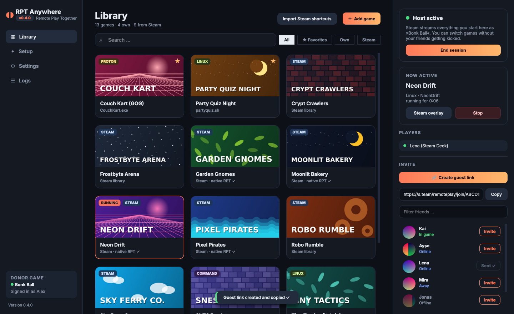
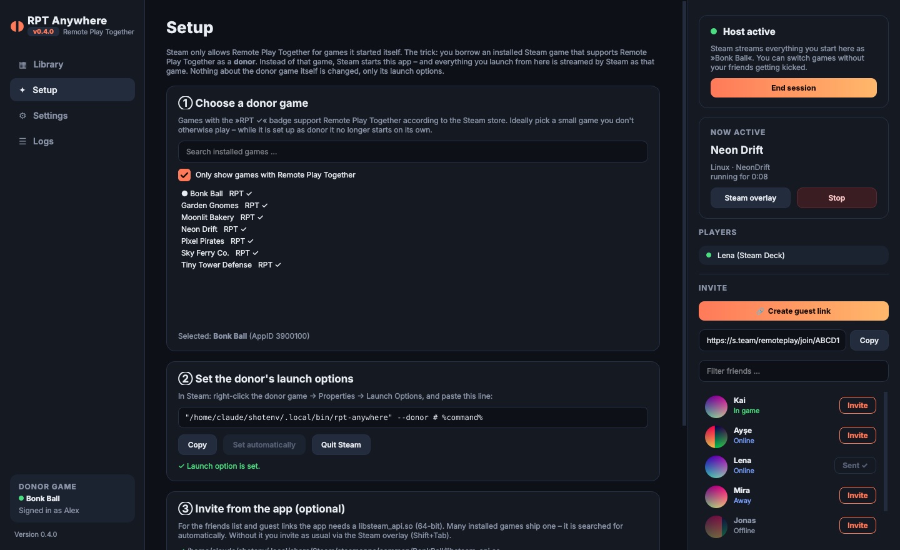
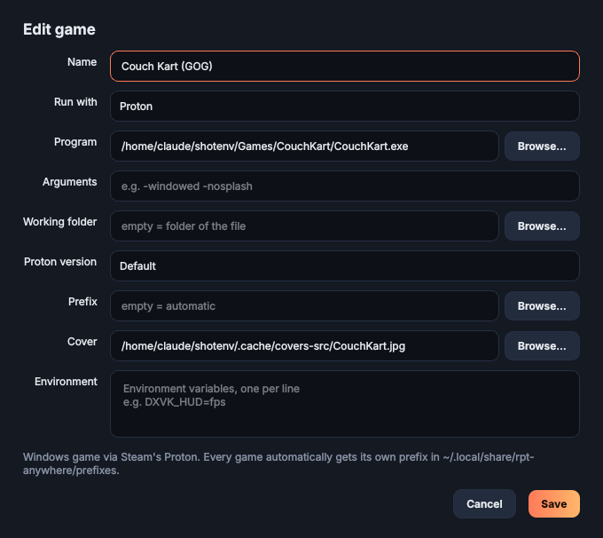

<div align="center">


# RPT Anywhere

**Steam Remote Play Together for _any_ game on Linux**

Steam games without Remote Play Together support, Windows games from GOG/Epic/itch.io via Proton, native Linux games, emulators or any command – stream them to your friends with Steam's Remote Play Together, invite them with one click or send a guest link.

[](https://github.com/Schnubbirunkel/rpt-anywhere/releases/latest)
[](LICENSE)


**English** · [Deutsch](README.de.md)



</div>

## Features

- **Any game** – Steam library, Windows games via Proton (incl. GE-Proton), Wine, native Linux programs, AppImages, emulators or any shell command
- **One-click invites** – friends list with avatars and online status, guest links for people without a Steam account (copied to the clipboard automatically), list of connected players
- **Switch games without kicking anyone** – the Remote Play session stays open when a game ends; just start the next one
- **Nice library** – cover art, favorites, search and filters, drag & drop to add games, import of your non-Steam shortcuts from Steam
- **Guided setup** – shows which installed games support Remote Play Together and are suitable as donor, sets the launch option for you (only that one line, with backup)
- **Live logs** in the app, an **emergency stop** and a **diagnostics** command for troubleshooting
- **English and German** interface (switchable in the settings, more languages welcome)
- Uses only **official interfaces**: Steam's launch options and the public Steamworks API – no patching or hooking of the Steam client

## How it works

Steam only allows Remote Play Together for games it started itself and that support it. RPT Anywhere uses the **donor** principle (like [RemotePlayDetached](https://github.com/smaTc/RemotePlayDetached) and [cooplauncher](https://github.com/MBaliver/cooplauncher)):

1. You pick an installed Steam game **with** Remote Play Together support as the *donor* and set its launch option to RPT Anywhere.
2. When Steam starts the donor, it starts the RPT Anywhere **agent** instead. The agent only needs the Python standard library, so it also runs inside Steam's runtime container (always the case for Proton games).
3. The app tells the agent what to start. The agent launches your game **as a real child of Steam** with Steam's own environment (overlay, AppID, Steam Input), so Steam streams it as the donor game. Invites, guest links and the friends list also go through the agent, using the official `ISteamRemotePlay` API.

```
 RPT Anywhere app (GUI) ──requests──▶ agent (in Steam's donor process) ──starts──▶ your game
          ▲                                   │                                   │
          └──────── status, friends, guests ◀─┘          Steam overlay + stream ◀─┘
```

## Installation

**Requirements:** Linux, the Steam client (native package recommended), Python 3.9+. PySide6 is installed automatically if your system doesn't provide it.

1. Download `rpt-anywhere-<version>.tar.gz` from the [latest release](https://github.com/Schnubbirunkel/rpt-anywhere/releases/latest).
2. Unpack it and run the installer:
   ```sh
   tar xzf rpt-anywhere-*.tar.gz
   cd rpt-anywhere-*/
   ./install.sh
   ```

This installs to `~/.local/share/rpt-anywhere/app`, adds the command `rpt-anywhere` to `~/.local/bin` and an entry to your application menu. No root needed. To update, run `install.sh` of the new version; `uninstall.sh` removes it again.

From source: `git clone https://github.com/Schnubbirunkel/rpt-anywhere && cd rpt-anywhere && ./install.sh` (or run `./bin/rpt-anywhere` directly).

## Setup (once, ~2 minutes)

Open RPT Anywhere → **Setup**:

1. **Choose a donor.** Games marked **RPT ✓** support Remote Play Together according to the Steam store. Ideally pick a small game you don't otherwise play – while it is the donor, it no longer starts on its own.
2. **Set the launch option.** Either click **Set automatically** (Steam must be closed; a backup of `localconfig.vdf` is created and only this one line is changed) or paste this into Steam → right-click the donor → *Properties → Launch Options*:
   ```
   "/home/YOU/.local/bin/rpt-anywhere" --donor # %command%
   ```
   Restart Steam once afterwards so it definitely picks up the option.
3. **libsteam_api.so** (for invites from the app) is searched for in your installed games automatically. Without it you invite friends as usual via the Steam overlay (Shift+Tab).



## Usage

- **Add games:** **＋ Add game**, drag & drop a file onto the window, or **Import Steam shortcuts**. Runners: *Native Linux*, *Proton* (own prefix per game, Steam Linux Runtime like Steam itself), *Wine*, *Command / script*. Installed Steam games appear automatically.
- **Click a game:** if the app isn't connected to Steam yet, it lets Steam start the donor, connects to the agent and then starts your game.
- **Invite** in the right panel: invite friends directly or **create a guest link**. Connected players are listed under *Players*.
- **Right-click a game:** edit, favorite, open folder, show log, hide.
- **Language:** Settings → *Language / Sprache* (English is the default).



### Command line

```
rpt-anywhere --run "Name or ID"      # start a game (via Steam/donor if needed)
rpt-anywhere --run 413150            # Steam game by AppID
rpt-anywhere --list                  # list your own games
rpt-anywhere --diagnose              # check Steam detection: libraries, executables, Proton, donor
rpt-anywhere --reset                 # emergency stop: end session, agent and last game
rpt-anywhere --repair-steam-config   # restore localconfig.vdf from RPT Anywhere's first backup
rpt-anywhere --print-launch-option   # print the donor launch option
```

The command line follows the language set in the app; `RPTA_LANG=de` selects it directly.

## Screenshots

| | |
|---|---|
|  |  |
| Settings with language selection and emergency stop | Live logs of the app, the donor placeholder and every game |

German interface:


## Troubleshooting

- **Nothing happens when the donor starts / "Donor not connected":** restart Steam once after setting the launch option. The *Logs* tab → *Donor placeholder* shows what Steam actually started (version, container yes/no).
- **Steam keeps showing the donor as running:** a process of the last session is still alive. Use the emergency stop (Settings or Logs tab) or `rpt-anywhere --reset`.
- **Executable not found:** `rpt-anywhere --diagnose` shows which file was detected for each game. Steam's launch configuration is read from its app cache (`appinfo.vdf` and the newer split `appcache/appinfo/appinfo_XX.vdf` format); otherwise the app searches the game folder. You can always set the executable in the edit dialog.
- **Overlay missing in a game:** programs that are not visible inside Steam's container (e.g. `/usr/bin/…`, Wine) are started directly on the host, where the overlay may be missing – the app tells you when that's the case. Flatpak/Snap apps run in their own sandbox.
- **Guest's mouse feels laggy:** input is transported by Steam itself, not by RPT Anywhere; the stream statistics usually point to network latency. A wired connection or a gamepad for the guest helps most.

## Limitations

- The game needs **local multiplayer** – guests appear as (virtual) controllers or keyboard/mouse, just like with regular Remote Play Together.
- **Anti-cheat and DRM launchers** (EA app, Ubisoft Connect, some Steam games) may refuse to start this way. For Steam games, *Run with the game's own Steam AppID* in the edit dialog sometimes helps.
- **Flatpak Steam** runs everything inside its sandbox; the native Steam package of your distribution is the most reliable choice.

## Adding a language

1. Copy `rpt_anywhere/locale/en.json` to e.g. `fr.json` and translate the values (keys are the German source strings; keep `{placeholders}` and `%s` unchanged).
2. Add the language to `LANGUAGES` in `rpt_anywhere/i18n.py`.
3. Run `python3 tools/i18n_check.py` – it reports missing strings and broken placeholders.

## Credits

Inspired by [RemotePlayDetached](https://github.com/smaTc/RemotePlayDetached), [cooplauncher](https://github.com/MBaliver/cooplauncher) and [RemotePlayWhatever](https://github.com/m4dEngi/RemotePlayWhatever). The appinfo format documentation of [SteamAppInfo](https://github.com/ValveResourceFormat/SteamAppInfo) was very helpful.

## License

[GPL-3.0](LICENSE). RPT Anywhere is not affiliated with Valve. Steam and Remote Play Together are trademarks of Valve Corporation.
