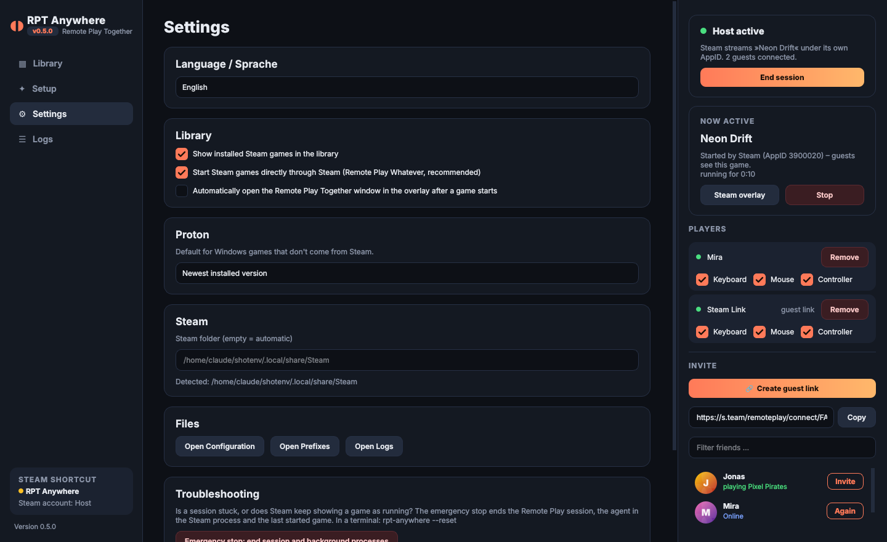
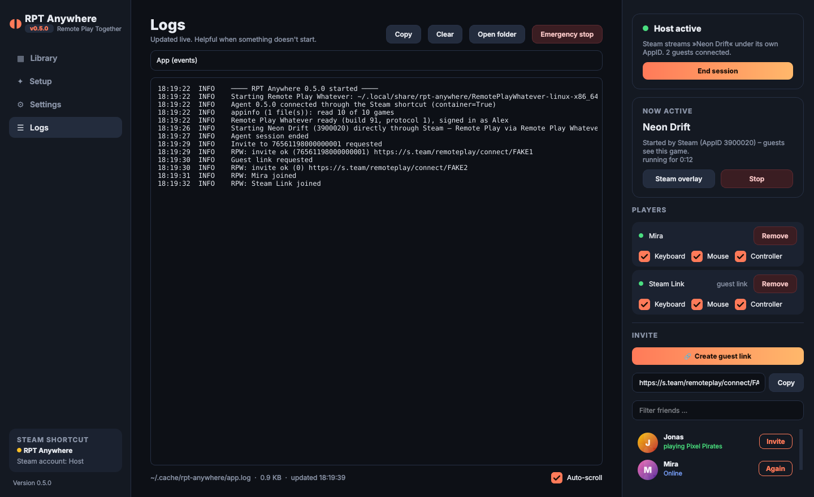
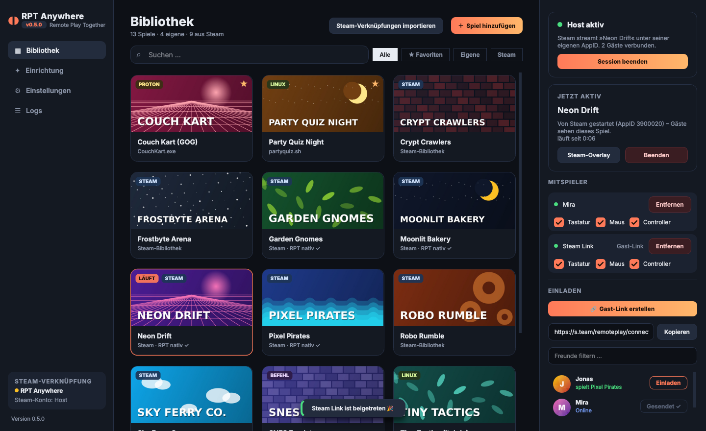

<div align="center">


# RPT Anywhere

**Steam Remote Play Together for _any_ game on Linux**

Steam games without Remote Play Together support – even with DRM, mods or their own Steam sign-in – plus Windows games from GOG/Epic/itch.io via Proton, native Linux games, emulators or any command: stream them to your friends with Steam's Remote Play Together, invite them with one click or send a guest link.

[](https://github.com/Schnubbirunkel/rpt-anywhere/releases/latest)
[](LICENSE)


**English** · [Deutsch](README.de.md)


</div>

## Features

- **Every Steam game** – Steam starts the game itself (DRM, mods, launch options all work); [Remote Play Whatever](https://github.com/Casual-Gamer8001/RemotePlayWhatever) opens the Remote Play Together session for it in the background, even if the game doesn't support it
- **Games outside Steam** – Windows games via Proton (incl. GE-Proton), Wine, native Linux programs, AppImages, emulators or any shell command, started by Steam through RPT Anywhere's own non-Steam shortcut – no donor game
- **Share my screen** – for games Steam can't start (other launchers): Steam shares your whole screen
- **One-click invites** – friends list with online status, guest links for people without a Steam account (copied to the clipboard automatically), connected players with per-guest keyboard/mouse/controller switches and a remove button
- **Nice library** – cover art, favorites, search and filters, drag & drop to add games, import of your non-Steam shortcuts from Steam
- **Guided setup** – downloads and updates Remote Play Whatever for you and creates the Steam shortcut (your other shortcuts stay untouched, with backup)
- **Live logs** in the app, an **emergency stop** and a **diagnostics** command for troubleshooting
- **English and German** interface (switchable in the settings, more languages welcome)

## How it works

Steam only offers Remote Play Together for games it started itself and that support it. RPT Anywhere has two ways around that:

**Steam games – Steam + Remote Play Whatever (default).** The app lets Steam start the game normally (`steam://rungameid/…`), so DRM, launch options and mods behave exactly as usual. It then drives [Remote Play Whatever](https://github.com/Casual-Gamer8001/RemotePlayWhatever) (RPW, MIT) in its window-less `--serve` mode. RPW talks to the running Steam client through Steam's own internal, undocumented functions (`IClientRemoteClientManager`, resolved by name so most Steam updates don't break it) and creates the Remote Play Together group, invites and guest links **for the game's own AppID**. RPT Anywhere downloads RPW on request and keeps it running in the background.

**Games outside Steam and screen sharing – Steam shortcut.** Like RPW's *Play a program that isn't in Steam* and *Share my screen*, these run as a non-Steam game. RPW creates a temporary shortcut for that through Steam's internal functions, which its `--serve` mode doesn't offer; RPT Anywhere therefore adds **one permanent non-Steam shortcut "RPT Anywhere"** to Steam once (Setup, part B).

1. When you click such a game, the app opens that shortcut (`steam://rungameid/…`), so Steam starts RPT Anywhere's small **agent** as a real non-Steam game, with overlay.
2. The agent starts your game (Proton with the Steam Linux Runtime, Wine, native, command) as its child, so Steam streams it. You can switch games without anyone being kicked.
3. Without a game, the shortcut just waits – Steam then shares your whole screen (*Share my screen*).

Invites, guest links and guest controls go through RPW in both cases.

```
 Steam game:    RPT Anywhere ──steam://rungameid/<AppID>──▶ Steam ──▶ game (own AppID)
 Other game:    RPT Anywhere ──steam://rungameid/<shortcut>──▶ Steam ──▶ agent ──▶ your game
 Share screen:  RPT Anywhere ──steam://rungameid/<shortcut>──▶ Steam ──▶ agent (waits) → whole screen
                RPT Anywhere ──--serve──▶ Remote Play Whatever ──▶ Steam: RPT group, invites, guest links
```

## Installation

**Requirements:** Linux, the Steam client (native package recommended), Python 3.9+. PySide6 is installed automatically if your system doesn't provide it.

1. Download `rpt-anywhere-<version>.tar.gz` from the [latest release](https://github.com/Schnubbirunkel/rpt-anywhere/releases/latest).
2. Unpack it and run the installer:
   ```sh
   tar xzf rpt-anywhere-*.tar.gz
   cd rpt-anywhere-*/
   ./install.sh
   ```

This installs to `~/.local/share/rpt-anywhere/app`, adds the command `rpt-anywhere` to `~/.local/bin` and an entry to your application menu. No root needed. To update, run `install.sh` of the new version; `uninstall.sh` removes it again.

From source: `git clone https://github.com/Schnubbirunkel/rpt-anywhere && cd rpt-anywhere && ./install.sh` (or run `./bin/rpt-anywhere` directly).

## Setup (once, ~2 minutes)

Open RPT Anywhere → **Setup**:

**A · Remote Play Whatever (Steam games).** Click **Download** – the app fetches the Linux AppImage from the [RPW releases](https://github.com/Casual-Gamer8001/RemotePlayWhatever/releases) into `~/.local/share/rpt-anywhere/` and starts it in the background. An AppImage you downloaded yourself (e.g. in `~/Applications` or `~/Downloads`) is found automatically, or pick it with **Choose file**. After a Steam update breaks it, click **Update**.

**B · Steam shortcut (games outside Steam, screen sharing).** Click **Create shortcut in Steam**. Steam is closed briefly, the shortcut "RPT Anywhere" is appended to your `shortcuts.vdf` (your other shortcuts stay byte for byte, a backup is written first) and Steam is started again.


## Usage

- **Click a Steam game:** Steam starts it; as soon as it runs you can invite. The session belongs to that game, so Steam shows it in your friends' list as usual.
- **Click another game:** Steam starts the "RPT Anywhere" shortcut, which starts your game. Switching games keeps everyone connected.
- **Share my screen** (right panel, when nothing runs): for games from other launchers – start the game however you like, guests see your screen.
- **Invite** in the right panel: invite friends directly or **create a guest link**. Connected players are listed under *Players*; for Steam games you can switch keyboard, mouse and controller per guest or remove a guest.
- **Add games:** **＋ Add game**, drag & drop a file onto the window, or **Import Steam shortcuts**. Runners: *Native Linux*, *Proton* (own prefix per game, Steam Linux Runtime like Steam itself), *Wine*, *Command / script*. Installed Steam games appear automatically.
- **Right-click a game:** edit, favorite, open folder, show log, hide.
- **Language:** Settings → *Language / Sprache* (English is the default). With Remote Play Whatever switched off in the settings, everything runs through a donor game as in earlier versions.


### Command line

```
rpt-anywhere --run "Name or ID"      # start a game (Steam games directly, others through the shortcut)
rpt-anywhere --run 413150            # Steam game by AppID
rpt-anywhere --list                  # list your own games
rpt-anywhere --diagnose              # check Steam detection: libraries, executables, Proton
rpt-anywhere --reset                 # emergency stop: end session, agent and last game
rpt-anywhere --repair-steam-config   # restore localconfig.vdf from RPT Anywhere's first backup
rpt-anywhere --guest-link APPID      # guest link via the public API for a game Steam started (RPT-enabled games only)
```

The command line follows the language set in the app; `RPTA_LANG=de` selects it directly.

## Screenshots

| | |
|---|---|
|  |  |
| Settings with language selection and emergency stop | Live logs of the app, the agent and every game |

German interface:



## Troubleshooting

- **"Remote Play Whatever does not match this Steam version" / invites fail after a Steam update:** Setup → **Update** fetches the newest RPW. RPW targets the **stable** Steam client; with the Steam beta things may break first. `rpt-anywhere --diagnose` shows which branch you are on.
- **Guest sees "Please wait" or "Host is busy":** Steam only shows guests the game while it is in front on your PC, and pauses guest input while Steam's overlay is open. Click the game / close the overlay with Shift+Tab.
- **Nothing happens after clicking a non-Steam game:** restart Steam once after creating the shortcut. The *Logs* tab → *Agent (started by Steam)* shows what Steam actually started.
- **Steam keeps showing "RPT Anywhere" as running:** a process of the last session is still alive. Use the emergency stop (Settings or Logs tab) or `rpt-anywhere --reset`.
- **Executable not found:** `rpt-anywhere --diagnose` shows which file was detected for each game. You can always set the executable in the edit dialog.
- **Guest's mouse feels laggy:** input is transported by Steam itself; the stream statistics usually point to network latency. A wired connection or a gamepad for the guest helps most.

## Limitations

- The game needs **local multiplayer** – guests appear as (virtual) controllers or keyboard/mouse, just like with regular Remote Play Together.
- **Remote Play Whatever uses Steam's internal functions.** A Steam update can break it until RPW is updated; RPW needs glibc 2.35+ and X11/XWayland.
- **Flatpak Steam** keeps its files in a sandbox; RPW and the shortcut work best with the native Steam package of your distribution.
- **Anti-cheat and DRM launchers** (EA app, Ubisoft Connect) may still refuse to run guests' input or the game outside their launcher.

## Adding a language

1. Copy `rpt_anywhere/locale/en.json` to e.g. `fr.json` and translate the values (keys are the German source strings; keep `{placeholders}` and `%s` unchanged).
2. Add the language to `LANGUAGES` in `rpt_anywhere/i18n.py`.
3. Run `python3 tools/i18n_check.py` – it reports missing strings and broken placeholders.

## Credits

Steam games run through [Remote Play Whatever](https://github.com/Casual-Gamer8001/RemotePlayWhatever) by Casual-Gamer8001 (fork of [m4dEngi's RemotePlayWhatever](https://github.com/m4dEngi/RemotePlayWhatever), MIT), which RPT Anywhere downloads and drives but does not bundle. The agent that starts games inside a Steam-launched process is inspired by [RemotePlayDetached](https://github.com/smaTc/RemotePlayDetached) and [cooplauncher](https://github.com/MBaliver/cooplauncher). The appinfo format documentation of [SteamAppInfo](https://github.com/ValveResourceFormat/SteamAppInfo) was very helpful.

## License

[GPL-3.0](LICENSE). RPT Anywhere is not affiliated with Valve. Steam and Remote Play Together are trademarks of Valve Corporation.
